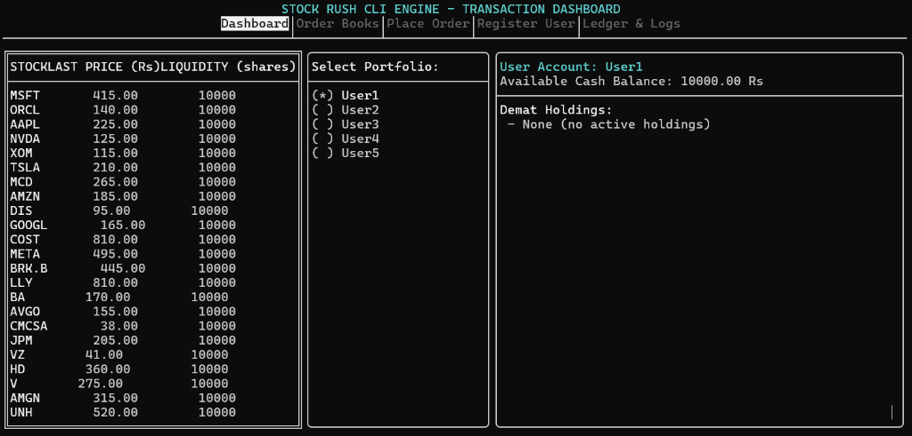

# Stock Rush CLI

**Stock Rush CLI** is a high-performance C++ stock trading simulation engine and interactive terminal user interface (TUI). It features an asynchronous matching engine built on a worker thread pool architecture, capable of processing over **210,000 orders/sec** with sub-2.5 microsecond matching latencies.



---

## Features

- **Interactive FTXUI Dashboard**: Real-time terminal UI with live portfolio balances, stock liquidity feeds, side-by-side bid/ask order books, order submission forms, and ledger execution history.
- **Multi-Threaded Order Matcher**: Asynchronous matching engine powered by an internal worker thread pool.
- **Financial Ledger & Escrow Settlement**: Balance and stock holding reservations on order placement, counterparty verification, atomic rollback on partial settlements, and zero leaked funds guarantees.
- **Zero-Friction Launch Scripts**: Single-command runners for Windows (`run.ps1`) and Linux/macOS (`run.sh`) that auto-build and run the application with no manual setup.
- **Headless Stress Testing Runner**: Dedicated benchmarking executable to evaluate raw engine throughput and latency percentiles under extreme loads.

---

## 🚀 Quick Start (Single-Command Runners)

You can build and run both the interactive dashboard and the benchmarks with one simple command:

### On Linux / macOS (`./run.sh`)
```bash
chmod +x run.sh

# 1. Launch interactive TUI (auto-builds if needed)
./run.sh

# 2. Run stress test benchmark (default: 1,000 orders)
./run.sh test

# 3. Run stress test with custom order volume
./run.sh test 10000

# 4. Rebuild or clean
./run.sh build
./run.sh clean
```

### On Windows PowerShell (`.\run.ps1`)
```powershell
# 1. Launch interactive TUI (auto-builds if needed)
.\run.ps1

# 2. Run stress test benchmark (default: 1,000 orders)
.\run.ps1 test

# 3. Run stress test with custom order volume
.\run.ps1 test 10000

# 4. Rebuild or clean
.\run.ps1 build
.\run.ps1 clean
```

---

## 🖥️ Interactive TUI Dashboard

The terminal interface provides 5 specialized tabs:

1. **`[ Dashboard ]`**: Live market view showing available stocks, prices, liquidity, and selected user account portfolios (available cash balance & demat holdings).
2. **`[ Order Books ]`**: Live bid/ask depth ladder and active order queues for any selected stock ticker.
3. **`[ Place Order ]`**: Interactive form to submit Buy/Sell, Market/Limit orders with custom quantities and limit prices.
4. **`[ Register User ]`**: Form to create new user accounts and seed initial trading balances.
5. **`[ Ledger & Logs ]`**: Historical audit log of all pending/active orders, matched trade executions, and transaction timestamps.

### Controls & Navigation:
* **Switch Tabs**: Use the `Left` and `Right` arrow keys while focused on the top tab bar.
* **Cycle Controls**: Press `Tab` to cycle focus forward through inputs/buttons, and `Shift+Tab` to cycle backward.
* **Select Options**: Use `Up`/`Down` arrow keys and `Enter` to select from lists, dropdowns, and radio buttons.
* **Submit Actions**: Focus on buttons (e.g., *Submit Order*, *Create User*) and press `Enter`.

---

## ⚡ Headless Stress Test Benchmark

Run the benchmarking tool to measure raw engine performance. Pass the number of concurrent orders to dispatch as an argument (defaults to 1,000):

```bash
# Via script:
./run.sh test 100000        # Linux/macOS
.\run.ps1 test 100000       # Windows

# Or direct executable:
./build/Release/StressTestRunner.exe 100000
```

### Benchmark Metrics Output:
```text
=== Running Headless Stress Test with 1000000 orders ===
Dispatched 1000000 orders in 42 ms.
Processing matches...

Orders Submitted:       1000000
Orders Executed:        1000000
Trades Generated:       363093

Total Runtime:          4747.8 ms

Throughput:             210,621 orders/sec
Average Match Latency:  2.2 μs
Median Latency:         1.8 μs
P95 Latency:            4.9 μs
P99 Latency:            7.5 μs

Worker Threads:         12
CPU Utilization:        100%
Peak Queue Size:        67425
---------------------------------------------------
=== Stress Test Complete ===
```

### Metrics Explained:
- **Throughput**: Orders matched, executed, and settled per second.
- **Latency Percentiles (Avg, Median, P95, P99)**: Sub-microsecond matching tail latency.
- **Peak Queue Size**: Maximum concurrency depth observed across internal priority queues.
- **Balance Integrity**: Verified zero phantom trades and complete fund reconciliation after multi-threaded matching.

---

## 🛠️ Manual Compilation (Optional)

If you prefer building manually without the runner scripts:

### Prerequisites:
- C++23 compatible compiler (`MSVC 19.30+`, `g++ 13+`, or `clang++ 16+`)
- **CMake 3.14+**

```bash
# 1. Configure
cmake -B build -S . -DCMAKE_BUILD_TYPE=Release

# 2. Build
cmake --build build --config Release
```

---

## 📄 License

This project is licensed under the MIT License - see the [LICENSE](LICENSE) file for details.
